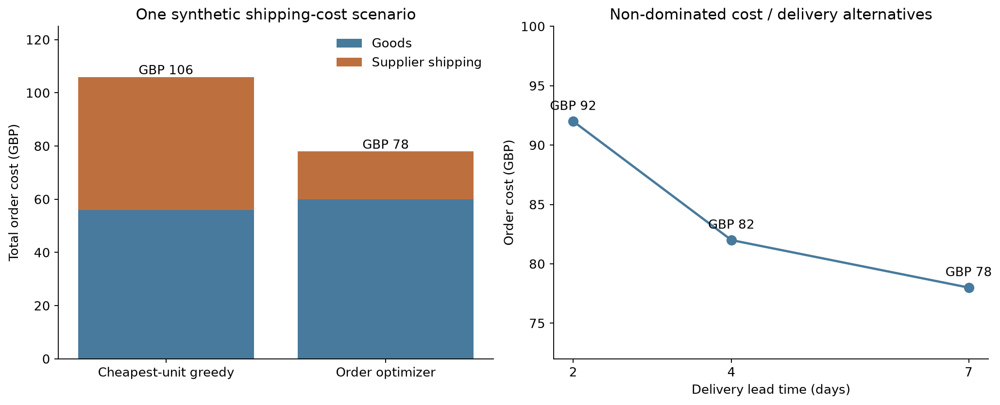

# AI Buyer Assistant

A local buyer decision-support project for artificial flowers and home décor. Catalogue search combines multilingual embeddings, cross-encoder reranking and Qwen tool routing. A separate procurement planner turns a structured brief and normalized supplier quotes into quantity-aware orders, cost/delivery alternatives and reviewable drafts.

## Procurement planning

```bash
python -m pip install -r requirements-planner.txt
python cli.py plan --brief data/procurement/brief.json --as-of 2026-10-22
python cli.py frontier --brief data/procurement/brief.json --as-of 2026-10-22
```

The brief specifies quantities, product attributes, total budget, delivery deadline and optional surplus/supplier limits. Quotes specify pack price, pack size, minimum packs, stock, shipping, lead time and validity dates. The planner never infers these fields from an old catalogue price. Missing hard requirements raise an error; unknown quote attributes fail eligibility checks.

The mixed-integer model allocates whole packs and charges shipping once per active supplier. It shares offer stock across requirement lines, checks the complete budget in integer currency units and verifies the decoded order independently of the solver matrix. Currency conversion and silent constraint relaxation are not performed.

The supplied scenario requires 24 stems and 12 bouquets. Its non-dominated alternatives are:

| Delivery | Total order cost |
| ---: | ---: |
| 2 days | GBP 92 |
| 4 days | GBP 82 |
| 7 days | GBP 78 |

These are synthetic quotes, not supplier offers. In this constructed example, cheapest-unit greedy costs GBP 106 after shipping, compared with GBP 78 for the optimized order. That difference is an illustration of coupled shipping costs, not measured commercial savings.



[Evaluation and raw results](results/EVALUATION.md) · [Optimization and workflow design](DESIGN.md) · [Local API](API.md) · [CV wording](PORTFOLIO.md)

## Review workflow and API

```bash
python -m procurement.api --quotes data/procurement/quotes.json --database local/plans.sqlite --port 8765
```

The loopback API creates drafts, reads records and approves/rejects an expected version. SQLite transactions and idempotency keys prevent duplicate records and conflicting reviews. The stored body includes the original brief, quote snapshot, exact totals and review events. Approval rechecks quote validity, snapshot identity and the remaining original delivery deadline. It never places an order or reserves inventory.

For offline draft creation, add `--database local/plans.sqlite --idempotency-key example-1` to the plan command. `--as-of` explicitly replays a dated scenario; HTTP uses its current UTC date and rejects request date overrides. This is a local, unauthenticated prototype rather than a deployed purchasing service.

## Algorithm and workflow checks

| Check | Observed result |
| --- | --- |
| Independent exhaustive reference | 80/80 cases agree: 26 feasible, 54 infeasible |
| Budget, deadline, stock and ordering transformations | 320/320 pass |
| Regression suite with planner dependencies | 28 tests pass, including HTTP and concurrent SQLite review |
| Largest synthetic timing scenario | 500 offers, 12 lines, 3,520 variables; median 214 ms over three local runs |

The small reference suite enumerates 2,361 allocations in total. It validates the constrained algorithm on those fixtures, not general recommendation accuracy. Larger scenario optimality is reported by HiGHS; they are not exhaustively enumerated. Timings include model construction and independent checking, but exclude HTTP, persistence and file IO.

```bash
python -m unittest discover -s tests -v
python verify_planner_results.py
python evaluate_planner.py
python benchmark_planner.py
```

The verifier recalculates the saved small-case references and accounting. The two evaluators generate new local results. To rebuild figures, install `requirements-report.txt` and run `python make_planner_report.py`.

## Catalogue search

Python 3.11 or 3.12. The bundled demo runs without third-party packages or model downloads:

```bash
python cli.py --demo search "浅粉色简约花束" --color 浅粉色 --form 花束 --currency GBP --max-price 10 --max-height-cm 40
python cli.py --demo details P0001
```

The 120 demo products are synthetic. Prices are GBP per item, not supplier quotes. Exact filters exclude missing attributes. Search terms affect ranking; use explicit flags for hard constraints. Colour and form filters use exact catalogue values.

## Neural search and chat

```bash
python -m venv .venv
python -m pip install -r requirements.txt
python download_catalog.py
python cli.py --backend neural --rerank search "浅粉色、简约的仿真花"
python cli.py --backend neural --rerank chat
```

Activate the virtual environment before installing dependencies. For CUDA training, install a suitable PyTorch build for your machine first.

The downloader streams Home and Kitchen metadata from [Amazon Reviews 2023](https://amazon-reviews-2023.github.io/), filters flower and plant titles, and saves up to 300 records in `data/public_products_raw.jsonl`. It scans at most 30,000 records per run and skips saved IDs. Increase `MAX_SCAN` in `download_catalog.py` if too few records are found. The source catalogue is downloaded separately and is not redistributed here.

Models download on first use:

| Stage | Model |
| --- | --- |
| Retrieval | `sentence-transformers/paraphrase-multilingual-MiniLM-L12-v2` |
| Reranking | `BAAI/bge-reranker-base` |
| Tool selection and answers | `Qwen/Qwen2.5-0.5B-Instruct` |

Inference runs on CPU. Models are cached in `models/`; set `BUYER_MODEL_CACHE` to reuse an existing cache. Model weights are excluded from Git. The lexical backend is a small offline baseline, not embedding search.

Chat accepts Chinese questions and asks for a product ID when needed. Type `quit` to exit. Tool names and arguments are validated before execution, and lookup IDs must appear in the user's message. Answers include product IDs and are prompted to use only retrieved evidence.

## Small tool-routing LoRA example

The included dataset has 12 training and 6 evaluation examples covering lookup, search and clarification. These are small synthetic tool-routing examples, not a recommendation benchmark.

```bash
python evaluate_finetune.py --output results/base.json
python finetune_agent.py
python evaluate_finetune.py --adapter models/agent_lora --output results/lora.json
python cli.py --demo chat --adapter models/agent_lora
```

Training requires CUDA and runs one epoch with rank-4 LoRA on the query and value projections. Prompt tokens are masked from the loss. The saved adapter is loaded explicitly for evaluation and chat. Evaluation reports valid-decision rate, action accuracy and exact argument accuracy without executing tools. Search argument matching is strict string matching; semantically equivalent rewrites can score as incorrect.

## Layout

| Files | Purpose |
| --- | --- |
| `cli.py`, `service.py`, `catalog.py` | Commands, filtering and catalogue validation |
| `retrieve.py`, `rerank.py` | Embedding retrieval and cross-encoder scoring |
| `agent.py`, `local_llm.py`, `tools.py` | Tool decisions and local generation |
| `finetune_agent.py`, `evaluation.py`, `evaluate_finetune.py` | Adapter training and routing evaluation |
| `main.py`, `rag.py` | Original structured-filter and RAG demonstrations |
| `tests/` | Offline regression tests |
| `procurement/` | Quote validation, integer planning, exact accounting, SQLite review and HTTP API |
| `evaluate_planner.py`, `benchmark_planner.py` | Enumerated reference checks and synthetic scaling scenarios |
| `results/EVALUATION.md` | Complete procurement measurements and limits |

Custom catalogues can be passed with `--catalog path.jsonl`. Each record needs `parent_asin` (or `id`) and a title or name; optional fields include features, description, details and price. Per-item budget filtering requires explicit `currency` and `price_basis: "per_item"`. Heights must be numeric `height_cm`; dimensions embedded in free text are not inferred.

## Checks and limits

```bash
python -m unittest discover -s tests -v
```

The original offline tests cover filtering, catalogue errors, grounded IDs, malformed tool calls, clarification and routing evaluation. Planner tests additionally cover pack/MOQ/stock interactions, exact money, shipping, infeasibility, expired quotes, time-limited incumbents, idempotent creation, competing reviewers and HTTP responses. GitHub Actions runs a dependency-free search job and a SciPy planner job on Python 3.11 and 3.12.

Public catalogue prices are historical USD values with varying pack sizes. They cannot establish current prices, availability or GBP per-item budgets. Neural scores measure relevance, not compliance with every requirement. Chat does not automatically turn natural-language budgets into hard filters; use search flags or a confirmed structured procurement brief. Generated answers can still be wrong. The planner assumes its normalized quote fields are accurate; it does not verify supplier inventory externally. There is no image analysis, live supplier integration, authenticated approval service or order/payment execution.

Related projects: [Environmental Language Model](https://github.com/Yulin2628/environmental-language-model) and [CMU AG News](https://github.com/Yulin2628/cmu-ag-news).
