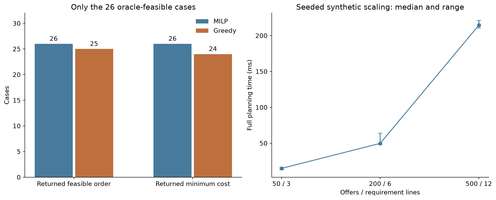

# Procurement planner evaluation

All quotes, supplier fees and requirements in this evaluation are synthetic. The experiment measures optimization and rule handling, not real-world purchasing savings, recommendation relevance or LLM accuracy. No supplier orders are placed.

## Small-case reference check

80 seeded instances contain four offers, three suppliers and one or two requirement lines. Independent exhaustive enumeration reimplements eligibility and accounting without the solver matrices. It enumerates 2,361 allocation combinations in total. This is a small reference suite, not a proof for every input.

| Outcome | Count |
| --- | ---: |
| MILP agreement with reference feasibility and minimum cost | 80/80 |
| Oracle-feasible cases | 26 |
| Oracle-infeasible cases | 54 |
| Feasible greedy orders on oracle-feasible cases | 25/26 |
| Minimum-cost greedy orders on oracle-feasible cases | 24/26 |
| Budget, delivery, stock and reorder transformations passed | 320/320 |

The greedy baseline ranks eligible offers by unit price, fills each requirement in input order, then checks the complete order including shipping, MOQ, stock, supplier count and budget. It never presents a known constraint violation as a recommendation. It is already optimal on most feasible small cases; the optimizer mainly handles coupled choices and cases where local decisions fail.

The transformed cases increase budget, relax the delivery limit, add known stock, or reorder offers. The verifier separately enumerates those transformed cases too. These are deterministic algorithm checks, not held-out customer evaluation. Input snapshots, hashes, raw solver statuses and allocations are retained in planner_evaluation.json.

The median full planning call across these small instances was 1.05 ms; the 95th percentile across different instances was 8.85 ms. Each case has one timing observation after a solver warmup. That percentile is not a repeated-serving latency estimate.

## Shipping and delivery example

The supplied demo requires 24 pink stems and 12 pink bouquets. Cheapest-unit greedy totals GBP 106.00: GBP 56.00 of goods plus GBP 50.00 shipping across two suppliers. The optimizer chooses a GBP 78.00 single-supplier order, including GBP 18.00 shipping. The GBP 28.00 difference is one deliberately constructed scenario, not observed commercial savings.

| Delivery days | Minimum feasible cost (GBP) |
| ---: | ---: |
| 2 | 92.00 |
| 4 | 82.00 |
| 7 | 78.00 |


## Scaling

Each synthetic quote book receives one unmeasured warmup and three repeated planning calls. Timing includes validation, eligibility, matrix construction, MILP and exact post-solve verification. It excludes model loading, HTTP, SQLite and JSON file IO. The largest instances are not exhaustively enumerated; their optimality status comes from HiGHS with relative MIP gap set to zero.

| Offers | Lines | Variables | Constraints | Median (ms) | Observed statuses |
| ---: | ---: | ---: | ---: | ---: | --- |
| 50 | 3 | 130 | 160 | 14.86 | optimal, optimal, optimal |
| 200 | 6 | 812 | 620 | 49.72 | optimal, optimal, optimal |
| 500 | 12 | 3520 | 1534 | 214.38 | optimal, optimal, optimal |

Runtime: Python 3.12.7, SciPy 1.18.1; CPU: Intel64 Family 6 Model 154 Stepping 3, GenuineIntel. Laptop timings and three repeats do not establish deployment capacity or worst-case MILP complexity.



## Workflow regression coverage

The suite covers exact money parsing, unsupported/missing input fields, pack rounding, aggregated MOQ/stock across lines, shipping charged once, supplier limits, expired/unknown/currency-incompatible offers, inert free-text instructions, independent plan verification, non-optimal solver status, idempotent creation, concurrent create/review, stale versions, quote changes, delayed approval, expiry and an HTTP create/retry/review round trip. It uses temporary SQLite databases and loopback sockets. Reviews change local state only; they do not contact suppliers.

## Reproduce

```bash
python -m pip install -r requirements-planner.txt
python -m unittest discover -s tests -v
python evaluate_planner.py
python benchmark_planner.py
python verify_planner_results.py
python -m pip install -r requirements-report.txt
python make_planner_report.py
```

The report builder uses the saved records. Rerunning the evaluators overwrites local evaluation outputs; no training or real catalogue access is needed.
